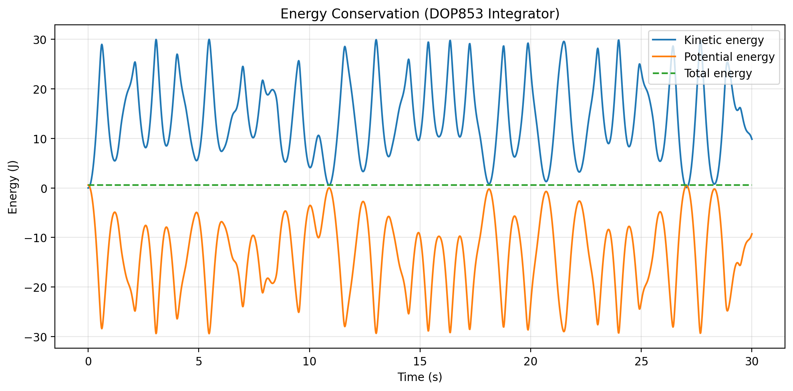

# Nonlinear Dynamics: Chaotic Double Pendulum Simulation

A high-accuracy physical simulation of a **double pendulum**, showcasing chaotic behavior, Lagrangian mechanics, and numerical integration of stiff non-linear ordinary differential equations (ODEs). 

Developed as part of a portfolio demonstrating competencies in mathematical modeling, scientific computing, and Python programming.

---

# Features
- **Rigorous Physics Modeling:** Derived using Lagrangian mechanics and solved via the high-order Runge-Kutta DOP853 method (`scipy.integrate.solve_ivp`).
- **Energy Conservation Validation:** Monitors total mechanical energy to guarantee numerical stability and precision ($\vert{}\Delta E\vert{} \approx 10^{-10}$).
- **Real-time Animation & Visualization:** Renders dynamic motion trajectories, historical motion trails, and energy conservation graphs over time.
- **Clean Architecture:** Built following modular software design principles (separation of physics engine, simulation logic, and execution entry point).

---

# Results: Energy Conservation
To prove the numerical stability of the solver, the system's kinetic, potential, and total energy are tracked throughout the simulation:

---
